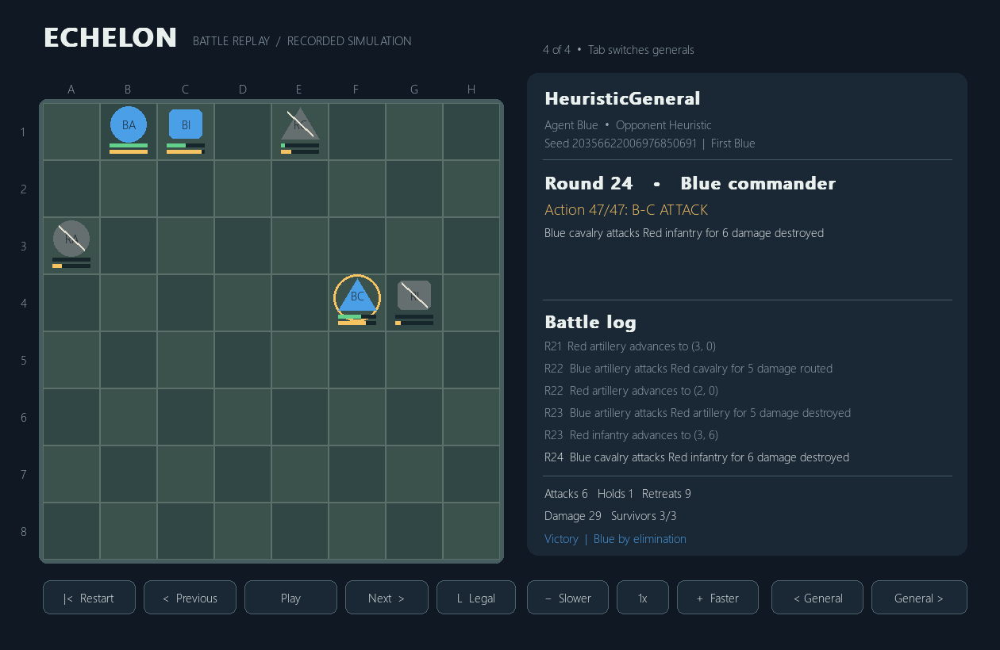
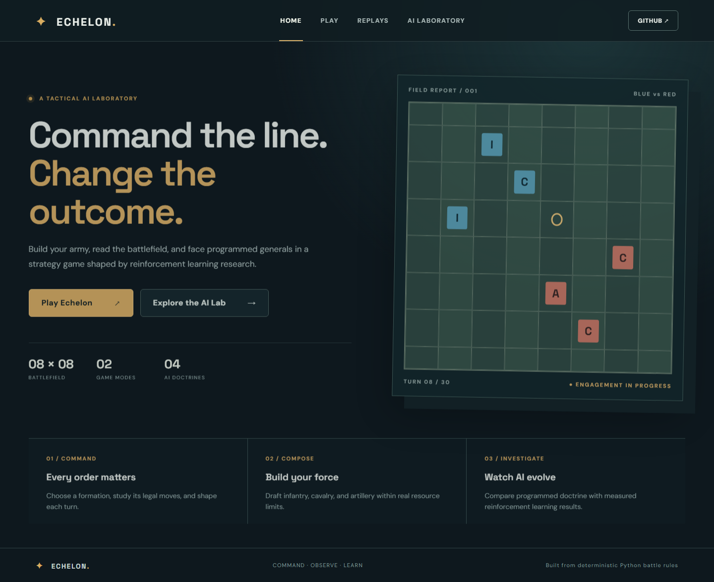
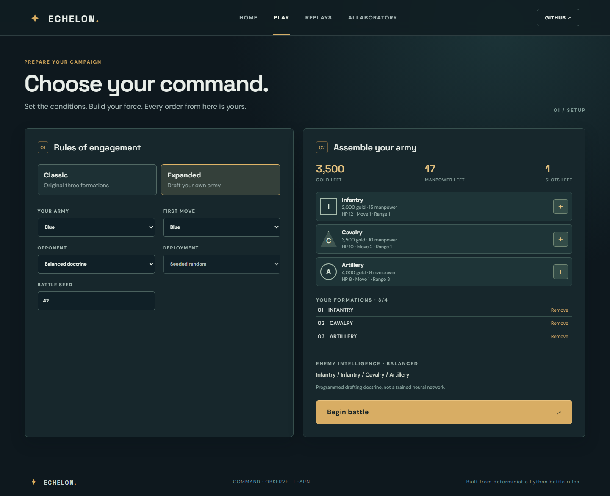
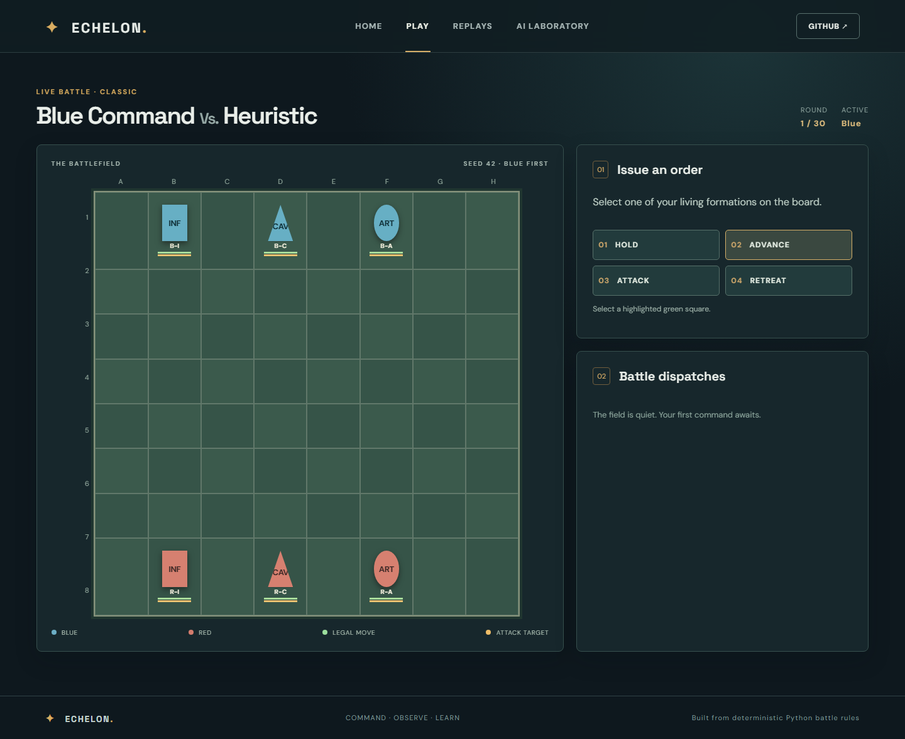
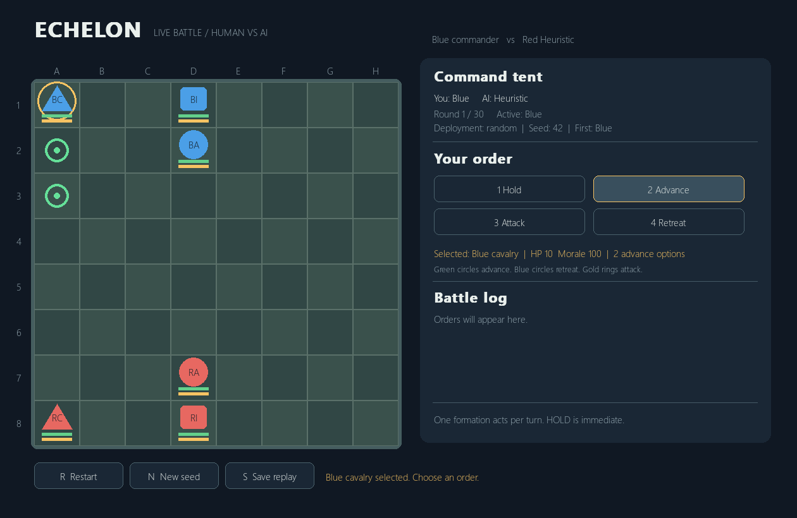
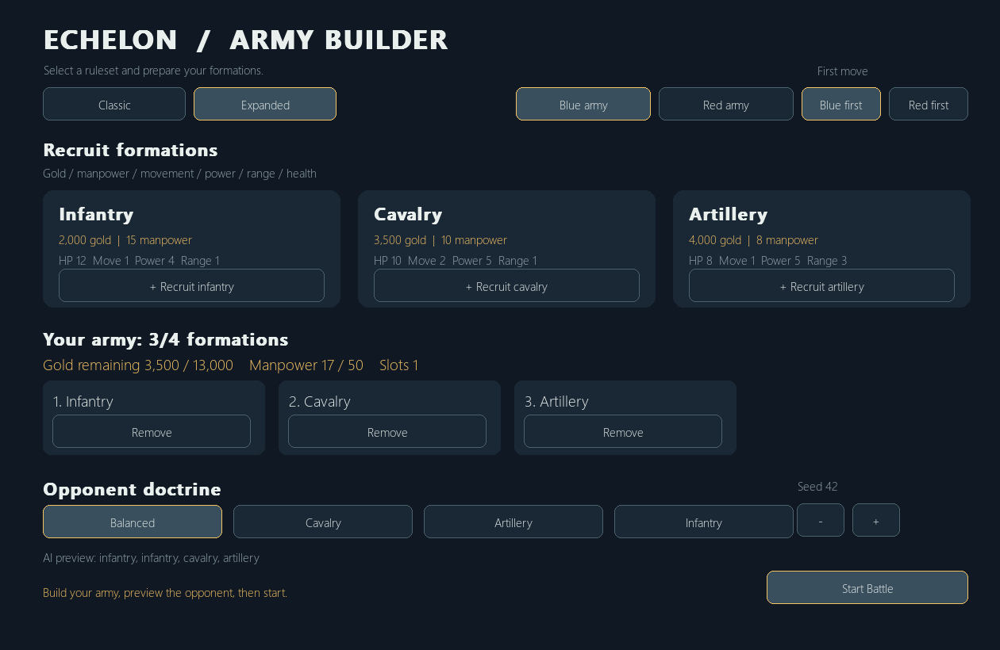
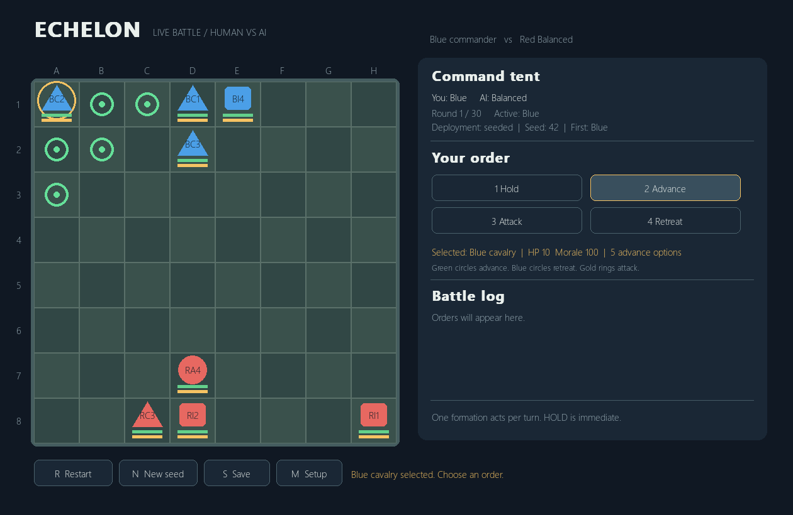

# Echelon

Echelon is a Python research project and browser-playable tactical strategy game in which human and AI generals command simplified Napoleonic armies. A deterministic 8×8 battle engine supports rule-based commanders and a Gymnasium environment for masked reinforcement learning. The project includes reproducible evaluations, Classic and Expanded human gameplay, and verified battle replays.



## What works today

- **Battle simulation:** Blue and Red each command infantry, cavalry, and artillery. The engine enforces legal movement, range, damage, morale, routing, alternating turns, and a documented 30-round tiebreak.
- **Baselines:** `RandomGeneral` and `HeuristicGeneral` use the same legal-order interface as the learning agent.
- **RL environment:** Gymnasium observations contain 63 numeric values; the stable 396-action encoding has a legal-action mask for `sb3-contrib` MaskablePPO. The engine remains independent of Gymnasium.
- **Research workflow:** Seeded mirrored deployments, separate training/development/final-test pools, checkpoint continuation, per-deployment evaluation, and verified JSON battle recording/replay.
- **Visual replay:** A pygame-ce viewer shows formations, health, morale, movement, attacks, event logs, outcomes, and tactical counts. It reads saved records and does not simulate combat.
- **Human vs AI:** A separate Pygame game lets you command Blue or Red against RandomGeneral, HeuristicGeneral, or a compatible saved MaskablePPO checkpoint. Only engine-legal destinations and targets are highlighted.
- **Expanded army builder:** Draft one to four formations under gold and manpower limits, face a seeded AI doctrine, and save versioned battles that open in the replay viewer. Classic remains available unchanged.
- **Browser edition:** React and TypeScript render a responsive battlefield and army builder. FastAPI calls the existing Python battle controllers, serves the built site and API from one origin, and holds bounded, expiring game sessions.
- **Command Mode:** A separate continuous 1200×800 battlefield with simultaneous formations, persistent orders, automatic combat, terrain, objective victories, programmed real-time AI, pause and speed controls, and version 3 deterministic replay verification.

**Stack:** Python 3.14 (tested on Windows), Gymnasium, NumPy, Stable-Baselines3, sb3-contrib, PyTorch, and pygame-ce. Versions are pinned in [requirements.txt](requirements.txt). The battle engine and text simulator use only the Python standard library.

## Windows setup

From PowerShell in the project directory:

```powershell
py -3.14 -m venv .venv
.\.venv\Scripts\python.exe -m pip install -r requirements.txt
.\.venv\Scripts\python.exe -m unittest discover -s tests -q
```

If Python 3.14 is already the `py` default, `py -m venv .venv` also works. Using `.\.venv\Scripts\python.exe` avoids PowerShell activation policy issues.

## Play in a browser locally

The lightweight web install excludes the ML and Pygame packages. Build once, then run the API and site from the same origin:

```powershell
py -3.14 -m venv .venv
.\.venv\Scripts\python.exe -m pip install -r requirements-web.txt
cd web
npm ci
npm run build
cd ..
.\.venv\Scripts\python.exe -m uvicorn echelon.web_api:app --host 127.0.0.1 --port 8000
```

Open **http://127.0.0.1:8000** and select **Command** on the setup screen to play the new real-time-with-pause ruleset. Choose Open Field or Ridge and Forest, then click or tap friendly formations to issue orders. Classic and Expanded remain available. The public web build does not include a PPO checkpoint. See the [Command guide](docs/phase11_command.md) and [browser edition guide](docs/phase10_web.md). **The browser game is not publicly deployed yet.**







## Simulate a battle

```powershell
.\.venv\Scripts\python.exe -m echelon --seed 42 --first Red
.\.venv\Scripts\python.exe -m echelon --battles 100 --seed 42
.\.venv\Scripts\python.exe -m echelon.benchmark --battles 500 --seed 42
```

The first command prints the board and every order. The benchmark pairs side and first-turn assignments across random and heuristic matchups. [Battle rules](docs/design.md) and [benchmark notes](docs/evaluation.md) explain the mechanics and tiebreak.

## Open the replay viewer immediately

The repository includes a small, verified [sample battle](examples/sample_battle.json). **No model checkpoint or training run is needed** to view it:

```powershell
.\.venv\Scripts\python.exe -m echelon.viewer --file examples/sample_battle.json
```

Press **Space** to play/pause, **Left/Right** to step, **Home** to restart, **Up/Down** to change speed, and **L** for recorded legal-order details. To compare four generals after reproducing their checkpoints:

```powershell
.\.venv\Scripts\python.exe -m echelon.export_comparison --output runs/phase7_comparison.json
.\.venv\Scripts\python.exe -m echelon.viewer --file runs/phase7_comparison.json
```

Press **1–4** to switch among untrained, Phase 5, selected Phase 6, and HeuristicGeneral. The [Phase 7 guide](docs/phase7.md) documents the file picker, controls, screenshots, and older Phase 6 recording format.

## Play Human vs AI

The default game needs no trained model:

```powershell
.\.venv\Scripts\python.exe -m echelon.play
.\.venv\Scripts\python.exe -m echelon.play --human Red --opponent heuristic --first Blue --deployment random --seed 42
```

To face the locally saved selected Phase 6 MaskablePPO checkpoint:

```powershell
.\.venv\Scripts\python.exe -m echelon.play --human Red --opponent ppo --checkpoint runs/phase6_mixed_50000/checkpoints/model_76624_steps.zip --first Blue --deployment random --seed 54
```

Click a friendly unit, choose an order with **1–4** or the buttons, and click a highlighted square or enemy. **M** opens the in-game setup screen to change army, opponent, deployment, first move, seed, or PPO file. **R** restarts the same seed, **N** starts the next seed, and **S** saves a completed replay under `runs/human_games/`. A missing checkpoint is an error; no other general is substituted. See the [Phase 8 guide](docs/phase8.md) for controls and validation.



## Draft an Expanded army

```powershell
.\.venv\Scripts\python.exe -m echelon.army_builder
.\.venv\Scripts\python.exe -m echelon.expanded_tournament --battles-per-pair 100 --seed 9000 --output runs/phase9_tournament.json
```

Choose **Classic** or **Expanded** in the builder. Expanded lets you recruit duplicate infantry, cavalry, or artillery under a **13,000 gold / 50 manpower / four formation** cap, choose your side and first move, and preview a Balanced, Cavalry, Artillery, or Infantry AI doctrine. Click **Start Battle** and use the same mouse controls as Phase 8. Press **M** to return to the builder after a battle. Classic PPO checkpoints work **only in Classic**, because their fixed observation and action encoding do not represent custom rosters. See the [Phase 9 guide](docs/phase9.md) for example builds, results, replay commands, and balance limitations.





## Train and evaluate

The first experiment trains against `RandomGeneral` with sparse terminal rewards (+1 win, −1 loss, 0 draw). Actions are masked during training and inference.

```powershell
.\.venv\Scripts\python.exe -m echelon.train --total-timesteps 25000 --seed 42 --output-dir runs/first_25000 --opponent random --deployment random
.\.venv\Scripts\python.exe -m echelon.evaluate --models runs/first_25000/untrained.zip runs/first_25000/train_final.zip --deployment-seeds 100 --split dev --seed 2027 --deployment random --output runs/development_evaluation.json
```

The Phase 6 continuation loaded the Phase 5 checkpoint and trained with a seeded 30% random / 70% heuristic opponent mix:

```powershell
.\.venv\Scripts\python.exe -m echelon.train --continue-from runs/first_25000/train_final.zip --total-timesteps 50000 --seed 606 --output-dir runs/phase6_mixed_50000 --random-fraction 0.30 --deployment random
```

Training files under `runs/` are intentionally excluded from Git. The original Phase 5 run requested 25,000 and completed **26,624** timesteps; the Phase 6 continuation completed **51,200 additional** timesteps. The selected checkpoint was `model_76624_steps.zip`, saved after 50,000 additional steps. See [training instructions](docs/training.md) and [Phase 6 analysis](docs/phase6_analysis.md) for the full settings, seed method, and reproduction commands. Checkpoints could later be attached to a versioned **GitHub Release** with their hashes and run metadata; they are not part of this source repository.

## Measured results

Score is `(wins + 0.5 × draws) / battles`. Rows use different scenario pools and should be compared **within** each pool.

| Evaluation | Policy | vs RandomGeneral | vs HeuristicGeneral |
| --- | --- | ---: | ---: |
| Phase 5 held-out, 25 deployments × 4 assignments | Untrained | 14.0% | 5.5% |
| Phase 5 held-out, same scenarios | Phase 5 trained | 95.0% | 38.0% |
| Phase 6 development, 100 deployments × 4 | Phase 5 trained | 93.6% | 31.5% |
| Phase 6 development, same scenarios | Selected continuation | 96.0% | 41.1% |
| Phase 7 frozen final test, 100 new deployments × 4 | Phase 5 trained | 91.0% | 36.1% |
| Phase 7 frozen final test, same scenarios | Selected continuation | 97.4% | 40.9% |

The selected policy improved its final-test score against RandomGeneral by **6.4 percentage points**. Against HeuristicGeneral the observed gain was **4.8 points**, but the paired 95% deployment-group interval was **−2.0 to +11.4 points**. **Improvement against HeuristicGeneral is not yet statistically conclusive**, and the policy still scores below 50% against it. The [frozen selection](docs/phase7_selection.json) and [archived final-test report](docs/phase7_final_test.json) preserve the choice and per-deployment results. The final-test pool is not used for further checkpoint selection.

## Project layout and roadmap

| Path | Responsibility |
| --- | --- |
| `echelon/model.py`, `engine.py`, `deployment.py` | Battle data, deterministic rules, seeded mirrored setup |
| `echelon/generals.py`, `simulation.py`, `benchmark.py` | Baseline commanders and text simulation |
| `echelon/env.py`, `train.py`, `evaluate.py` | Gymnasium wrapper, masked PPO, paired evaluation |
| `echelon/recording.py`, `replay_data.py`, `viewer.py` | Battle recording, validation, and visual playback |
| `echelon/encoding.py`, `ppo_general.py`, `live_game.py`, `play.py` | Shared RL encoding, trained opponent adapter, live controller, and Human vs AI screen |
| `echelon/drafting.py`, `doctrines.py`, `expanded*.py`, `army_builder.py` | Expanded roster rules, doctrine drafts, battles, tournaments, replay verification, and builder UI |
| `echelon/web_api.py`, `web/` | Lightweight FastAPI sessions and React/TypeScript browser interface |
| `echelon/command_engine.py`, `command_general.py`, `command_game.py`, `command_recording.py` | Separate Command simulation, heuristic AI, server clock, and version 3 replay verifier |
| `Dockerfile`, `render.yaml`, `.github/workflows/web.yml` | Single-service build, Render example, and automated web checks |
| `echelon/export_comparison.py`, `final_test.py` | Matched replays and frozen final comparison |
| `tests/`, `docs/`, `examples/` | Regression tests, research reports, sample replay |

Possible future research and gameplay work includes terrain, additional unit types, learned drafting, self-play, and comparisons with other AI algorithms. These features are not implemented yet.
