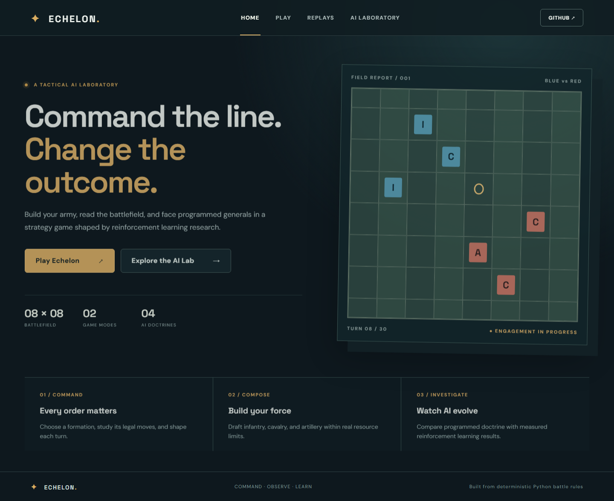
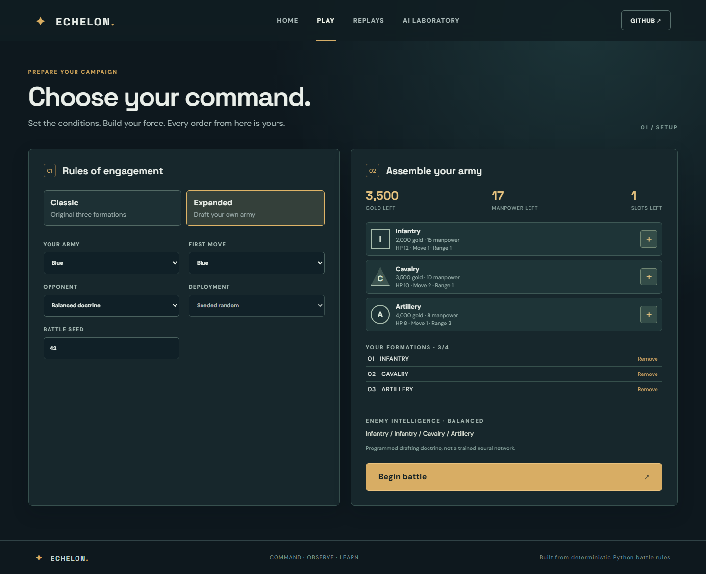
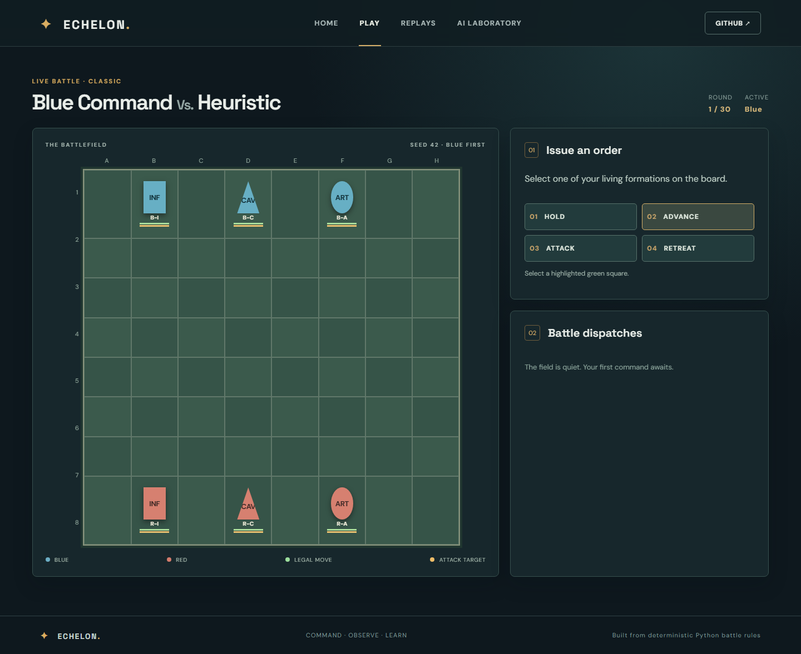
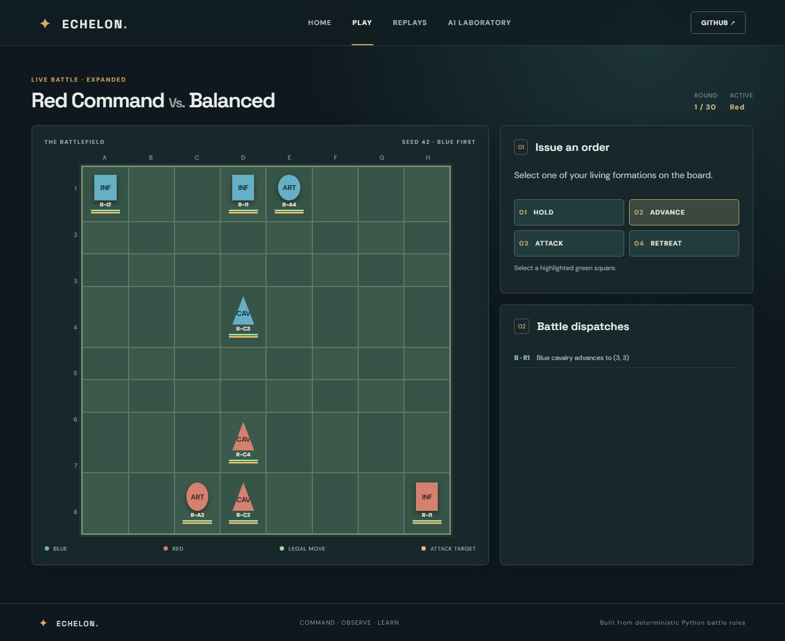

# Phase 10: Browser edition

The browser edition plays **Classic** and **Expanded** through a FastAPI
server. React draws the board and sends one selected order to the server. The
server holds the battle state and calls the existing Python `LiveGame` or
`ExpandedGame`, which in turn use the established combat engines. Browser code
does not calculate movement, damage, morale, routing, or winners.









## Run locally on Windows

From the repository root in PowerShell:

```powershell
py -3.14 -m venv .venv
.\.venv\Scripts\python.exe -m pip install -r requirements-web.txt
cd web
npm ci
npm run build
cd ..
.\.venv\Scripts\python.exe -m uvicorn echelon.web_api:app --host 127.0.0.1 --port 8000
```

Open `http://127.0.0.1:8000` in a browser. The production-style path serves
the built Vite files and `/api` from the same origin. For frontend development,
run the backend above and use `cd web; npm run dev` in a second terminal, then
open Vite's local URL. Vite proxies `/api` to the Python server. A visitor to
an eventual public deployment needs only a normal browser.

The web-only requirements install FastAPI and Uvicorn. They do **not** install
PyTorch, Gymnasium, NumPy, Stable-Baselines3, or Pygame. The research and
desktop dependencies remain in `requirements.txt`. Import-time NumPy and
Gymnasium imports were moved inside `record_battle()` so scripted gameplay
and its replay verification can run in the small web environment.

## What is playable

- Classic: fixed or seeded deployment; Blue or Red; RandomGeneral or
  HeuristicGeneral; either army first.
- Expanded: valid one-to-four-unit roster under the Phase 9 gold and manpower
  limits; seeded deployment; all four programmed drafting doctrines; either
  army first. The server previews the deterministic opposing draft.
- Click a friendly formation, choose Hold, Advance, Attack, or Retreat, then
  click an engine-legal highlighted square or enemy. Hold issues immediately.
- Read the battle log and final winner, surviving formations, and damage.
  Restart the same setup, start a new battle, or download a verified JSON
  replay after the battle ends.
- Load bundled Classic or Expanded replay examples, or upload a saved replay.
  The React viewer reads recorded snapshots and never recalculates combat.
- The AI Laboratory shows previously published **Phase 7 frozen final-test**
  results. Expanded doctrines are programmed heuristics, not neural networks.

The Classic PPO model is hidden unless `ECHELON_PPO_CHECKPOINT` names a real
server-side file that loads with compatible spaces. The lightweight Docker
image contains no checkpoint or ML packages, so its public menu offers only
RandomGeneral and HeuristicGeneral. A separate inference-enabled image could
later add the exact pinned training dependencies and selected checkpoint;
no checkpoint URL or client-supplied model path is accepted. Expanded does not
offer PPO because the trained policy assumes exactly six formations.

## HTTP contract and sessions

`GET /api/config` returns unit stats, draft limits, and **available** opponents.
`POST /api/draft/purchase` and `/api/draft/remove` validate roster changes;
`POST /api/draft/preview` validates a roster and returns the seeded AI roster.
`POST /api/games` creates a server-held game, `GET /api/games/{id}` returns its
state, `POST /api/games/{id}/orders` submits an order, and
`GET /api/games/{id}/replay` exports a completed replay. `GET /api/health`
returns a health response. `/api/replays/sample/classic` and `/expanded`
provide read-only examples.

An order uses the existing engine vocabulary, for example:

```json
{"unit_id":"B-C","kind":"ADVANCE","target":[2,3]}
```

Attack targets are unit-ID strings; Hold has a `null` target. The API rejects
extra fields and illegal orders. Only server-generated, engine-legal orders
change state. Session IDs use `secrets.token_urlsafe(24)`; the default store
holds at most **256** games and expires idle games after **3,600 seconds**.
Sessions are in one worker's memory and **disappear when the server restarts**.
This MVP therefore runs one Uvicorn worker and has no accounts, database, or
matchmaking. In-memory sessions are unsuitable for multiple independent
workers or instances without a shared store. Do not send important unsaved
games expecting them to survive a restart.

## Tests

```powershell
.\.venv\Scripts\python.exe -m pip install -r requirements.txt
.\.venv\Scripts\python.exe -m unittest discover -s tests -q
cd web
npm ci
npm test
npm run build
npx playwright install chromium
```

With the built backend running at `http://127.0.0.1:8000`, run
`npm run test:e2e` in `web/`. The browser suite finishes a Classic battle as
Blue and an Expanded battle as Red, checks replay controls, and checks the
mobile viewport. The test screenshots are tracked beside this guide. The
GitHub workflow runs lightweight backend tests, frontend tests and build, and
the browser suite on pushes and pull requests.

## Render deployment preparation

`Dockerfile` builds Vite in a Node stage and runs FastAPI with only
`requirements-web.txt` in a Python stage. `render.yaml` describes **one**
Docker web service, free plan, and `/api/health` health check. Uvicorn binds
to Render's `$PORT` on `0.0.0.0`. The Docker daemon was unavailable during
local Phase 10 validation, so the container build itself needs its first
execution in CI or Render. The frontend build, same-origin serving, API, and
browser tests were run locally.

To publish after review, connect this GitHub repository to a Render account,
create a Blueprint from `render.yaml` (or one Docker web service using the
root `Dockerfile`), select the branch containing the merged web code, confirm
the free plan and health path, and deploy. Verify `/api/health` and finish a
real browser battle at the assigned `onrender.com` URL before calling the site
live. Render's [Docker guide](https://render.com/docs/docker),
[Blueprint reference](https://render.com/docs/blueprint-spec), and
[web service guide](https://render.com/docs/web-services) document these
settings. `ECHELON_MAX_SESSIONS` and `ECHELON_SESSION_TTL` may be adjusted in
the service environment. `ECHELON_PPO_CHECKPOINT` is optional and should be
unset in the lightweight deployment.

No Render credentials or service were used in this phase. **There is no
public Echelon browser URL yet.** The site currently runs locally and is
deployment-ready pending account authorization and an actual hosted smoke
test. Free services may sleep between visits, which also loses memory-held
sessions.
