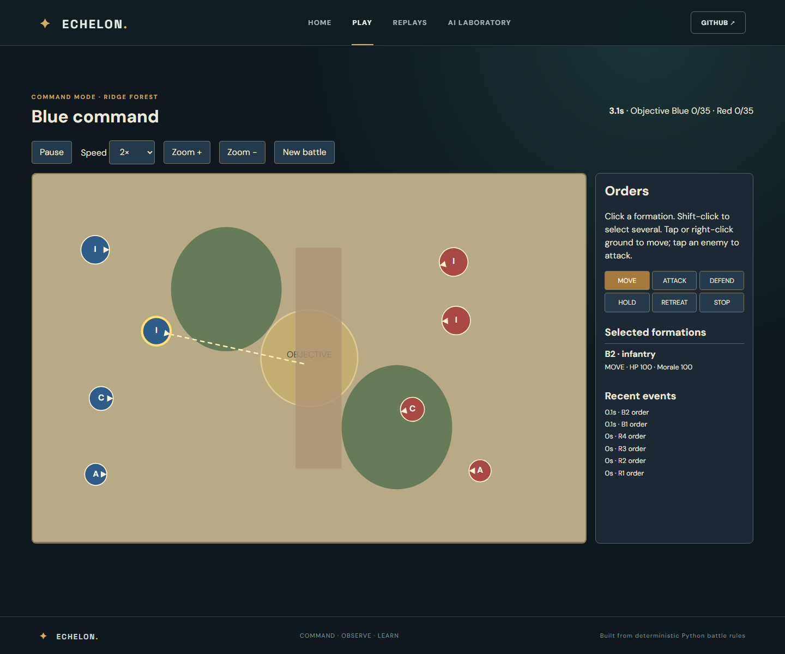
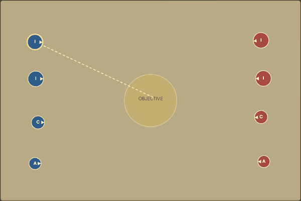

# Phase 11: Command Mode

Command is a separate real-time-with-pause ruleset. Classic and Expanded retain their 8×8 turns, observations, actions, checkpoints, research comparisons, and existing replay formats. No Phase 11 result is comparable to the earlier PPO evaluations.

## Play

Use the browser launch commands in the README. Select Command, a map, Blue or Red, an AI preference, and a seed. Select a friendly formation with a click or tap; Shift-click selects several. Choose Move or Defend and click the ground, or right-click the ground to move. Click an enemy to attack. Hold, Retreat, and Stop issue immediately. Pause and choose 0.5×, 1×, 2×, or 4× speed. Download a version 3 replay from the victory screen.

## Architecture and rules

`command_engine.py` owns deterministic combat and fixed 0.1-second ticks on a 1200×800 continuous field. Formations are tactical entities, not individually simulated soldiers. Orders persist and both sides move in each tick. Group moves preserve lateral spacing; up to six waypoints can be supplied through the API. Formations turn toward movement, stay inside the field, and separate after movement. The server alone validates commands and calculates attacks, morale, objectives, and results. React renders server snapshots and never computes combat.

`command_general.py` selects orders every three simulated seconds. Balanced favors the center, aggressive pursues enemies, and defensive holds when approached. Artillery retreats from close threats and cavalry seeks enemy artillery. A two-second decision lock limits order oscillation. These are programmed policies and do not use Classic PPO.

`command_game.py` advances at most two seconds of monotonic server elapsed time per request. An accumulator produces fixed ticks; pause does not accrue time. No client tick count or background worker is accepted. Polling uses REST every 150 ms. The browser uses `requestAnimationFrame` to interpolate positions and headings between server snapshots without changing battle outcomes. Sessions share the existing bounded, expiring, single-process store. Run one Uvicorn worker; a restart discards live sessions.

Infantry has 100 health, speed 48, range 76, damage 8, and 1.2-second cooldown. Cavalry has 85 health, speed 94, range 64, damage 11, and 1.5-second cooldown. Artillery has 65 health, speed 30, range 390, damage 13, and 3-second cooldown. Damage scales with morale, facing, defensive orders, and terrain. Side attacks gain 20% and rear attacks 40%. Hold and Defend reduce incoming damage 18%. A cavalry charge builds after one second of movement and adds 65% against exposed targets; braced infantry counters it. Artillery deals only 40% damage at close range. Health zero destroys a formation; morale below 25 routes it. All formulas are deterministic.

Open Field has no cover. Ridge and Forest gives a 20% ridge defense, 15% forest defense, 35% forest movement penalty, forest concealment from distant artillery, and ridge obstruction across the center. Both maps have a central objective. An uncontested formation within 105 units accumulates control time; 35 seconds wins, while contested or abandoned control decays. Elimination also wins. At 900 simulated seconds, surviving health and objective progress break a potential stalemate.

`command_recording.py` verifies version 3 replays by reconstructing the seed, map, roster, timestamped player commands, and AI decisions through the authoritative engine and comparing the final snapshot and event stream. Replays also include checkpoints every 100 ticks for future seekable playback. The Classic and Expanded viewers continue to handle their existing formats.

## API

`POST /api/command` creates a session. `GET /api/command/{id}` advances and returns state. `POST /api/command/{id}/orders` accepts `ids`, `kind`, `target`, and optional `waypoints`. `POST /api/command/{id}/control` accepts `paused` and `speed`. `GET /api/command/{id}/replay` exports a finished battle. All order IDs are checked for ownership and effectiveness; positions must be within battlefield bounds.

## Known limits

The browser uses a static camera center with zoom and no drag pan. Polling may show small position steps on a slow connection. Server state is in memory and tied to one process. The initial slice uses equal four-formation rosters; Command does not yet expose the Expanded drafting budget. The version 3 verifier is available in Python; the browser replay viewer currently supports Classic and Expanded. There is no multiplayer or independent soldier behavior.

