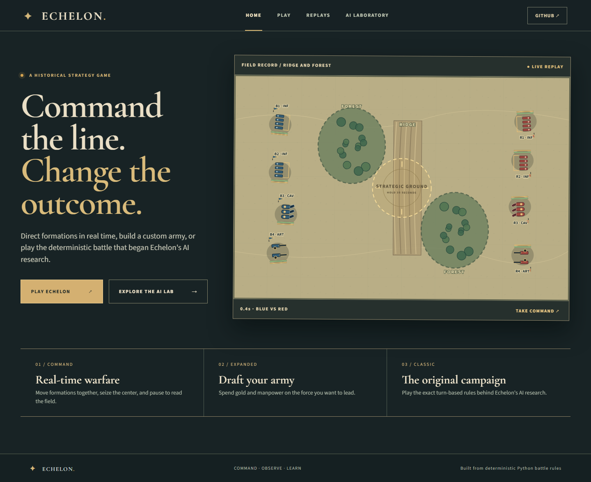
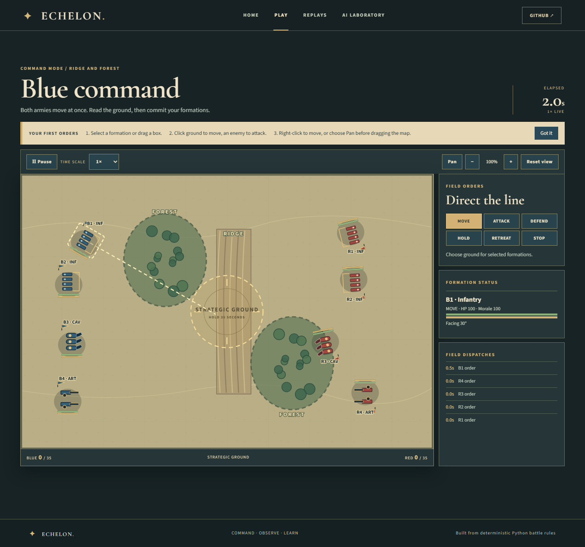
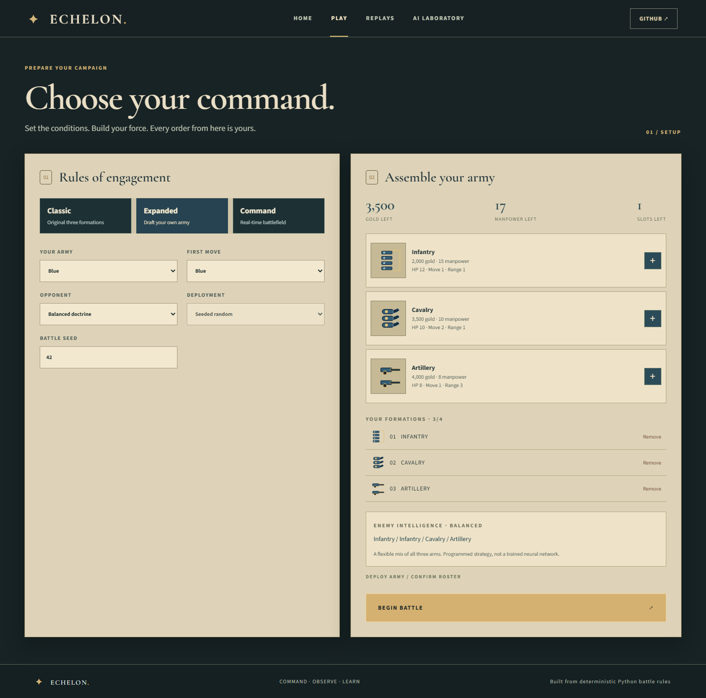
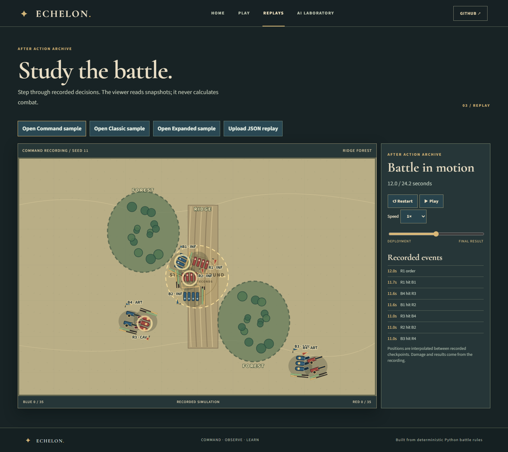
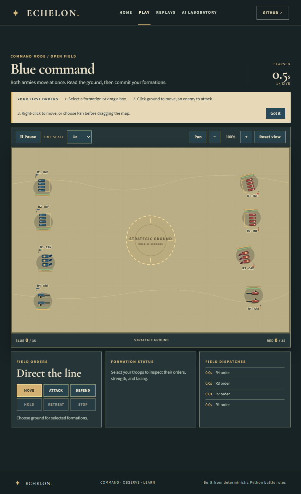
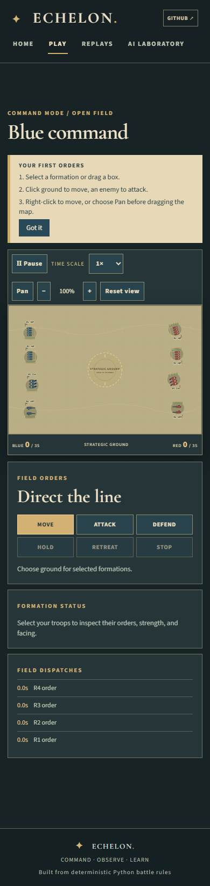

# Phase 12: Field command visual overhaul

Phase 12 changes the browser interface and recording frequency. It does not change Classic, Expanded, or Command combat rules, AI decisions, the research environment, PPO encodings, or checkpoint compatibility. The server remains authoritative for all live orders and outcomes. The redesign has not been deployed.

## Field artwork

The browser draws original SVG infantry lines, cavalry groups, artillery batteries, regimental pennants, selection marks, formation facing, health and morale bars, routed state, orders, objective progress, and brief impact rings from server events. `CommandBattlefield.tsx` is a renderer shared by live play, the landing page, and the Command replay theater. It does not calculate attacks or legal commands.

Open Field remains unobstructed. Ridge and Forest draws exactly the ridge rectangle at x=570–670, y=160–640 and the two elliptical forests centered at (420,250) and (790,550), radii (120,135). The central objective circle has radius 105 world units. Trees and contour lines are decorative within these regions; they do not claim additional collisions or terrain mechanics.

## Controls

Click or tap a friendly formation. Shift-click adds or removes formations. Drag a box around friendly formations to select them. Select Move or Defend, then click ground; select an enemy to attack. Hold, Retreat, and Stop are immediate. Right-click ground gives a Move order. Use Pan before dragging the field or drag with the middle mouse button. Mouse wheel and toolbar buttons zoom; Reset view restores the full field. The field suppresses orders after drag gestures. Multiple simultaneous touches cancel selection gestures. A dismissible first-battle tutorial describes the controls.

The control bar, selection detail, dispatches, and battle outcome view use the same recorded server state. A sequence guard prevents an older poll response from replacing a newer order response. Positions and headings interpolate between authoritative snapshots for display only. A browser frame sampler records actual frame intervals in `window.__echelonMetrics` for QA.

## Replay theater

Version 3 Command JSON can be uploaded or opened from a finished battle. The bundled `examples/sample_command.json` is a small reproducible sample, verified by the Python replay verifier. Playback supports play, pause, restart, speed, timeline scrubbing, recorded events, and the final result. The browser validates the map, units, coordinates, monotonic commands and events, terminal state, and checkpoint gaps. Truncated or malformed recordings are rejected. Classic and Expanded replays retain their existing viewer.

New Command recordings save compact position checkpoints every 20 ticks (2 simulated seconds), with events stored once. Phase 11 recordings with checkpoints every 100 ticks remain loadable. The browser interpolates positions between recorded checkpoints; health, morale, orders, and outcomes come from recorded snapshots and events. For deterministic verification, use `echelon.command_recording.verify` in Python.

## Visual QA and performance

Screenshots were captured in headless Chromium at desktop 1440×900, tablet 900×1100, and mobile 390×844. The capture script checks horizontal overflow. Interactive Playwright coverage completes battles in all three modes, operates Command drag selection and camera gestures, loads and scrubs version 3 replays, and rejects malformed uploads.

At desktop 1440×900, a short local headless Chromium capture measured **60.0 FPS** over 100 frames with **16.8 ms** 95th-percentile frame interval. Complete-battle Playwright runs varied from **24.1 to 37.6 FPS** with p95 intervals of **83–133 ms** while the browser also polled the server. This does not establish a sustained 60 FPS result. The renderer now updates only formation transforms between server snapshots, but further profiling on target hardware is needed. Raw measurements are in `phase12_performance.json`.

The Phase 11 production Vite build produced 254.09 kB JavaScript (78.64 kB gzip) and 17.83 kB CSS (5.16 kB gzip). The Phase 12 build produces 274.88 kB JavaScript (84.37 kB gzip) and 31.20 kB CSS (8.24 kB gzip). This is an increase of **5.73 kB gzip JS** and **3.08 kB gzip CSS**. The original vector artwork adds no runtime image library.

## Known limitations

The map is a readable 2D tactical view, not individual-soldier animation. Touch camera movement uses the Pan control and zoom buttons; pinch zoom is not implemented. The browser rejects structurally invalid replays but does not run Python's deterministic replay verification. Historical version 3 files with 10-second checkpoint gaps have coarser motion interpolation. Sustained 60 FPS was not observed in complete headless battles; performance on ordinary laptops and mobile devices remains unmeasured.
