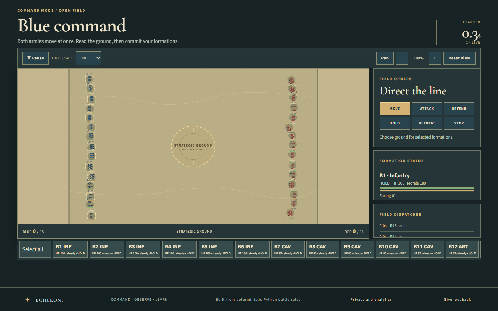
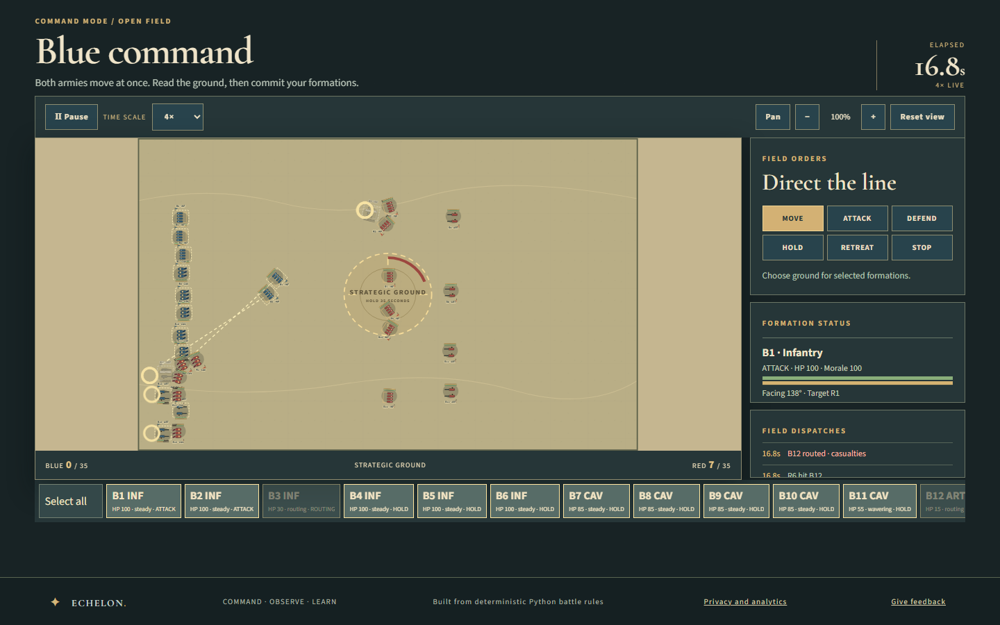
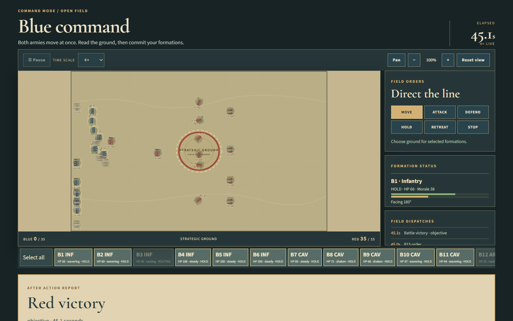

# Phase 14: Command warfare expansion

Command is now the recommended default in the browser. Classic, Expanded, PPO checkpoints, research results, and their engines remain separate. This is a simplified fictional strategy game, not a claim of historical accuracy.

[Watch the complete large battle GIF](phase14_grand_battle.gif). It was captured from a live 15v15 browser session at 4× simulation speed. The source capture script is `web/scripts/capture-phase14.mjs`.

## Versioned rules and compatibility

- Version 3 recordings still use the frozen `command_engine.py` and `command_general.py`. The bundled version 3 sample verifies and plays in the browser.
- New public Command sessions use `command_engine_v4.py`, `command_general_v4.py`, and recording format 4. The recording stores size, both independent rosters, budget, manpower, commands, events, and checkpoints. Verification reconstructs the original deterministic simulation. The browser replay viewer reads checkpoints and never runs combat.
- Classic and Expanded are unchanged. Version 4 rules are not used by the research environment, PPO action encoding, or saved checkpoints.

## Army drafting and scale

The gold and manpower costs are inherited from Expanded: infantry 2,000/15, cavalry 3,500/10, artillery 4,000/8. Duplicate types are legal; IDs stay unique. The AI uses the same resource limits but drafts its own seeded roster. Each personality has a bounded composition preset and shuffles its deployment deterministically. Under tighter custom limits, it fills a legal roster using balanced, aggressive, or defensive type weights.

| Size | Max per side | Default gold | Default manpower | Field |
| --- | ---: | ---: | ---: | ---: |
| Skirmish | 4 | 13,000 | 50 | 1200×800 |
| Field battle | 8 | 26,000 | 100 | 1400×900 |
| Grand battle | 15 | 50,000 | 180 | 1600×1000 |

Budgets and manpower may be configured through the API from 4,000 to twice the default gold and 15 to twice the default manpower. This bound keeps public requests predictable. The UI supplies legal balanced presets and a draft counter. The grand preset is six infantry, five cavalry, and four artillery (45,500 gold, 172 manpower). Larger maps spread initial lines across the full height; group moves preserve spacing. A 15-unit order remains below the existing 16 KiB request limit. Session caps, expirations, polling limits, analytics consent, privacy controls, feedback, and error recovery remain in place.

## Morale, orders, and combat

- Morale states: steady (70–100), shaken (45–69), wavering (25–44), routing (below 25). Lower morale reduces damage, as in prior Command rules. Casualties and cavalry hits reduce morale; a nearby friendly break causes an additional 8-point shock within 145 field units. The version 4 API accepts bounded `morale` options: `casualty` damage multiplier 0.5–3 (default 1.35), `cavalry` 0.5–4 (default 1.8), and `break_shock` 0–20 (default 8). These values are stored in version 4 recordings for exact verification. The event log records state changes and reasons.
- Routed formations withdraw toward their own edge and cannot take orders or fight. After eight seconds they can rally once, at 38 morale, only if at least 30% health remains and no effective enemy is within 190 units. A second break is final. This limits route/rally loops.
- Artillery in version 4 needs 1.5 seconds to set up after movement, cannot fire while moving or without setup, has 12 shots, and reloads in 4.5 seconds instead of 3. It retains long range and its prior close-range damage penalty.
- Infantry holding or defending is more resistant to a cavalry charge (0.55 charge modifier). The programmed general braces infantry against cavalry at close range. Flank/rear bonuses, facing, ridge/forest protection, defensive posture, and charge indicators follow the earlier Command rule path. The inspector shows facing, health, morale, and order.
- The version 4 battle time limit is 180 seconds. The objective still requires 35 uncontested seconds. The programmed AI assigns targets with a crowding penalty, spreads defenders across the center, and locks tactical changes for four seconds. It is deterministic and programmed; no new RL model was trained.

## Reproducible balance diagnostic

Run `python -m scripts.phase14_balance` to reproduce [all 96 legacy and 96 version 4 matchups](phase14_balance.json) over seeds 0–5. Each composition stays within the **skirmish** gold/manpower limits: balanced 2 infantry/1 cavalry/1 artillery (11,500/48), artillery heavy 3 artillery (12,000/24), infantry heavy 3 infantry (6,000/45), cavalry heavy 3 cavalry (10,500/30). Resource spending is not equal, and the six seeds are a development diagnostic, not a final independent test pool. The version 3 diagnostic temporarily substitutes Red types in memory because that legacy constructor mirrors both armies; the original version 3 code and recordings are untouched.

| Matchup (both orientations, 12 games) | Legacy wins | Version 4 wins | Version 4 mean duration | Version 4 mean routing events |
| --- | --- | --- | ---: | ---: |
| Balanced vs artillery heavy | Artillery 12 | Balanced 12 | 84.7 s | 4.5 |
| Infantry heavy vs artillery heavy | Artillery 12 | Artillery 12 | 43.8 s | 5.4 |
| Cavalry heavy vs artillery heavy | Cavalry 12 | Cavalry 12 | 10.2 s | 3.0 |
| Balanced vs cavalry heavy | Cavalry 12 | Balanced 7, cavalry 5 | 67.2 s | 9.4 |
| Infantry heavy vs cavalry heavy | Cavalry 12 | Infantry 12 | 15.5 s | 3.0 |

The earlier artillery-heavy diagnostic reaches the 900-second legacy limit in every balanced matchup. Version 4 makes artillery effective against slow infantry but vulnerable to cavalry and mixed armies. The revised bracing rule prevents cavalry-only armies from overwhelming infantry in this sample. The full JSON includes winner counts, draws, mean duration, routing counts, and termination reasons for every pairing. Additional player testing remains necessary before making broad balance claims.

## Browser performance and test conditions

Profile command: `SIZE=grand HEADFUL=1 node web/scripts/profile-command.mjs` with the app running locally. The script runs a complete 15v15 battle at 4×, logs Chromium tracing and `requestAnimationFrame` intervals, checks hits, then downloads and opens its version 4 replay. `INTERACTIVE=1` adds multiple selection, zoom, and pan. Measurements are from Windows 11 Home 10.0.26200, Intel Core Ultra 7 155H (22 logical processors), Intel Arc Graphics, Playwright Chromium 159, device scale 1. These are single runs, not confidence intervals.

| Condition | Viewport | Average FPS | p95 frame interval | Frames |
| --- | --- | ---: | ---: | ---: |
| Headful desktop, before marker scaling | 1440×900 | 60.02 | 17.1 ms | 912 |
| Headful desktop, after marker scaling | 1440×900 | 59.99 | 17.6 ms | 871 |
| Headful desktop, multiple selection, pan, zoom, hits | 1440×900 | 57.68 | 17.2 ms | 1,081 |
| Headless desktop, before marker scaling | 1440×900 | 34.94 | 83.4 ms | 574 |
| Headless desktop, after marker scaling | 1440×900 | 41.23 | 66.6 ms | 682 |
| Headless mobile layout | 390×844 | 59.32 | 16.8 ms | 1,360 |
| Current AI draft, headful desktop | 1440×900 | 59.90 | 17.8 ms | 840 |
| Current AI draft, headful interactive | 1440×900 | 59.96 | 17.5 ms | 917 |
| Current AI draft, headless desktop | 1440×900 | 44.17 | 50.0 ms | 710 |
| Current AI draft, headless mobile | 390×844 | 59.92 | 16.7 ms | 1,133 |
| Final viewport layout, headful desktop | 1440×900 | 59.86 | 17.0 ms | 976 |
| Final viewport layout, headful interactive | 1440×900 | 59.98 | 17.3 ms | 1,212 |

The grand deployment's full-size SVG hit areas overlapped and blocked clicks. The verified fix scales grand markers to 62% and field markers to 80%, with the same scale applied during interpolation. The roster bar remains a precise fallback. This change did **not** measurably improve headful FPS. The first six rows use the earlier random weighted AI draft; the next four use the final bounded composition presets; the last two use the final compact viewport layout and recording options. These are separate scenarios rather than a controlled before/after comparison. Repeated final-layout runs varied: earlier headful desktop and interactive runs measured 56.39 and 54.68 FPS, respectively, with 18.2 ms p95 intervals. The final layout keeps the map, orders, and formation bar within a 1440×900 desktop viewport; the inspector scrolls when many units are selected. Headless desktop tracing showed much higher paint times and occasional long tasks than headful; those observations suggest headless rendering overhead, but they do not isolate a single underlying cause. There is no claim of sustained 60 FPS across hardware or all effects.

## Verification and limitations

- Python: `.venv/Scripts/python.exe -m unittest discover -s tests -q` for the existing full research/game suite; `python -m pytest -q tests/test_command_v4.py` for drafting, independent rosters, group orders, 4v4/8v8/15v15 deployments, morale, rally, complete version 4 replay verification, API limits, and concurrent grand sessions.
- Frontend: `npm test`, `npm run build` in `web`. Browser: `npm run test:e2e` with `ECHELON_BASE_URL` set to the local API. The browser suite covers Classic, Expanded, Command, previous replay playback, Phase 13 consent/feedback/session recovery, grand selection and mobile width.
- A single worker keeps Command sessions in memory. Restarts expire games; the UI offers a new battle. The public create rate is 12/minute per address and the existing 16 KiB body limit remains. The concurrent test creates eight grand sessions and polls them in parallel, within that create limit; it is a smoke test, not a production load benchmark.
- Artillery-only and other extreme compositions can still reach the time limit. The field is a strategy game abstraction; player feedback and a larger balance sample should guide later tuning.
