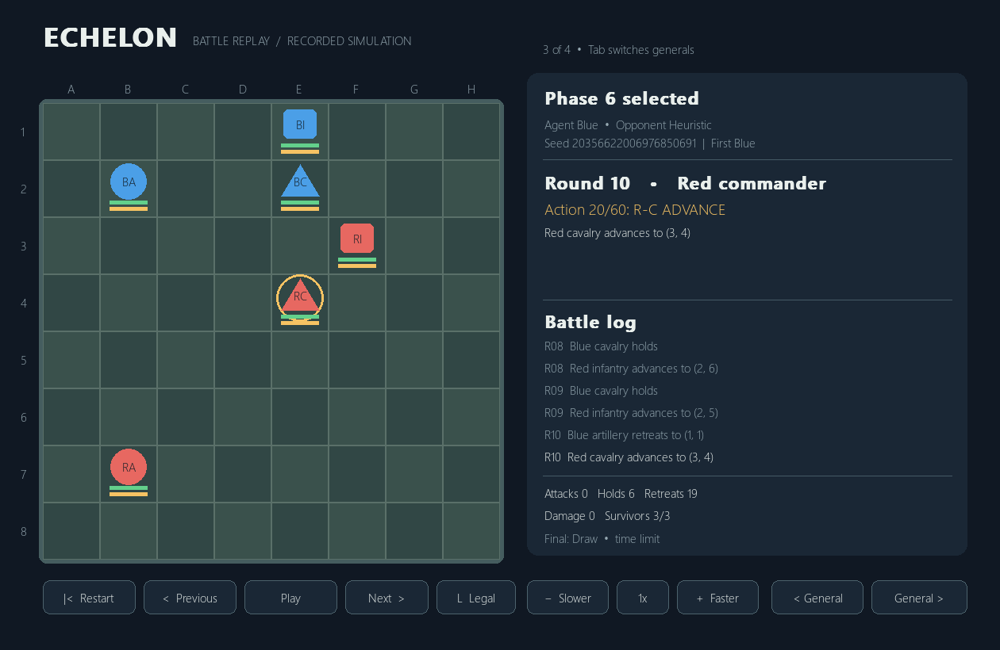
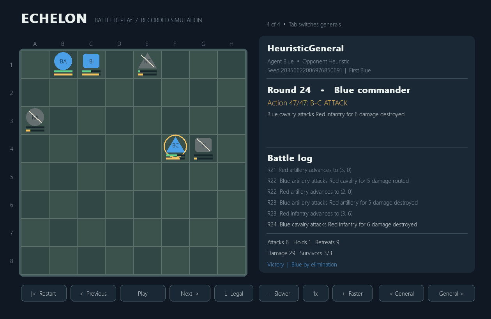

# Phase 7: frozen final test and visual replay

## Frozen choice and one final test

The [selection manifest](phase7_selection.json) was written before opening the
final-test pool. It fixes the Phase 6 **50,000-additional-step checkpoint**
(`model_76624_steps.zip`) against the Phase 5 original (`train_final.zip`),
their SHA-256 hashes, the 100 final deployment indices, four mirrored
side/first-turn assignments per index, and both opponents. The selected
checkpoint scored 41.1% against HeuristicGeneral on development scenarios;
the Phase 6 final checkpoint scored 37.1%, so it was not selected.

`echelon.final_test` checked the checkpoint hashes and verified that all 100
final seeds were distinct and outside **2,938 recorded training and earlier
evaluation seeds**. The final pool uses a separate numeric seed range. No
final-test report existed before this run. Both models saw the same deployed
maps, sides, first turns, and initial opponent random seeds. Different model
orders can later change which random choices are available to the opponent.
The test ran once. The complete per-deployment report is archived as
[phase7_final_test.json](phase7_final_test.json); `runs/phase7_final_test.json`
is the original local output. The final-test results will not be used to
choose another checkpoint.

Each row below is **400 battles** on 100 distinct deployments, four mirrored
games per deployment. Score is (wins + 0.5 × draws) / 400.

| Opponent | Policy | W/L/D | Score | Decisive W/L | Time-limit W/L/D | Mean rounds | Invalid actions |
| --- | --- | ---: | ---: | ---: | ---: | ---: | ---: |
| RandomGeneral | Phase 5 original | 344/16/40 | 91.0% | 110/0 | 234/16/40 | 28.12 | 0 |
| RandomGeneral | Phase 6 selected | 385/6/9 | 97.4% | 162/1 | 223/5/9 | 27.56 | 0 |
| HeuristicGeneral | Phase 5 original | 62/173/165 | 36.1% | 56/62 | 6/111/165 | 27.35 | 0 |
| HeuristicGeneral | Phase 6 selected | 119/192/89 | 40.9% | 82/98 | 37/94/89 | 26.38 | 0 |

The selected policy gained **6.4 percentage points** against RandomGeneral.
Across 100 paired deployment groups, 37 improved, 57 tied, and 6 worsened.
A 10,000-resample bootstrap that samples *deployment groups* gives an
illustrative 95% interval of **+3.9 to +8.9 points**.

Against HeuristicGeneral, it gained **4.8 points**. Fifty-one deployment
groups improved, 14 tied, and 35 worsened; the corresponding interval is
**−2.0 to +11.4 points**. This result is consistent with a modest gain, but
does not conclusively confirm one. Decisive wins rose from 56 to 82, while
decisive losses also rose from 62 to 98. Time-limit wins rose from 6 to 37,
and time-limit losses fell from 111 to 94. The overall score remains below
50%, so the selected policy has not surpassed HeuristicGeneral. No further
checkpoint selection or tuning used this final-test pool.

## Visual replay viewer

The viewer reads the saved JSON snapshots in `echelon/replay_data.py` and
renders them in `echelon/viewer.py` with pygame-ce. It never applies orders or
calculates combat. The separate Phase 6 replay verifier still reapplies
orders to check the recorder. The viewer accepts both old Phase 6 battle
arrays and new labeled comparison bundles. A missing or inconsistent file
produces a readable error. `requirements.txt` pins pygame-ce 2.5.8, which
provides a [Windows CPython 3.14 wheel](https://pypi.org/project/pygame-ce/2.5.8/).

The screen shows an 8×8 battlefield, unit shapes (square infantry, triangle
cavalry, circle artillery), Blue/Red color, green health bars, gold morale
bars, the highlighted acting formation, movement interpolation, an attack
line and impact pulse, the current round and commander, recent event log,
recorded legal-order information, final tactical statistics, and a
Victory/Defeat/Draw message with the recorded win condition. Older Phase 6
files contain legal counts only; new comparison exports include full legal
order lists. Units that are routed or destroyed appear muted.





### Controls

| Key | Action |
| --- | --- |
| Space | Play or pause |
| Left / Right | Previous or next action |
| Home | Restart battle |
| Up / Down, + / − | Faster or slower playback, 0.25×–8× |
| L | Show legal-order count/list and selected order |
| Tab, 1–4 | Switch between loaded generals |
| Esc | Close viewer |

The bottom buttons provide the same controls. If no `--file` is supplied, a
Windows file picker opens. `--battle-index` selects one battle from an older
Phase 6 array, and `--recording-index` selects the initial general from a
comparison bundle.

## Matched AI evolution recordings

`echelon.export_comparison` loads the untrained model, Phase 5 model, frozen
Phase 6 selected checkpoint, and HeuristicGeneral. It runs each on the **same
development scenario** and exports one bundle with all four labeled battles.
The default uses development seed base 2027, deployment index 0, assignment
Blue/Blue-first, against HeuristicGeneral. It verifies every recording with
the Phase 6 replay checker and confirms identical starting snapshots. It
does not use the final-test pool. Each policy may lead to different later
opponent moves because the tactical situation changes.

From PowerShell in the project root:

```powershell
.\.venv\Scripts\python.exe -m pip install -r requirements.txt
.\.venv\Scripts\python.exe -m echelon.viewer --file examples/sample_battle.json
.\.venv\Scripts\python.exe -m echelon.export_comparison --output runs/phase7_comparison.json --deployment-index 0 --assignment-index 0 --opponent heuristic
.\.venv\Scripts\python.exe -m echelon.viewer --file runs/phase7_comparison.json
```

Press **1** for untrained, **2** for Phase 5, **3** for the selected Phase 6
checkpoint, or **4** for HeuristicGeneral. To open two existing recordings
directly, pass both after `--file`:

```powershell
.\.venv\Scripts\python.exe -m echelon.viewer --file runs/phase6_analysis/untrained_battles.json runs/phase6_analysis/train_final_battles.json --battle-index 0
```

To reproduce the viewer screenshot or exercise the playback loop without a
visible window:

```powershell
.\.venv\Scripts\python.exe -m echelon.viewer --file runs/phase7_comparison.json --recording-index 2 --screenshot docs/phase7_viewer.png --action-index 20
.\.venv\Scripts\python.exe -m echelon.viewer --file runs/phase7_comparison.json --recording-index 2 --demo-seconds 2
.\.venv\Scripts\python.exe -m unittest discover -s tests -q
```

## Limits and next use

The viewer is intentionally read-only. It supports the current six unit IDs
and 8×8 open battlefield. Animation interpolates between recorded positions
and marks recorded attacks; it does not simulate a new battle or infer hidden
orders. The final-test uncertainty still includes no gain against the
heuristic, and its 100 deployment groups are all drawn from the existing
simple deployment generator. Future research should design a new experiment
and a new held-out pool before another model comparison.
