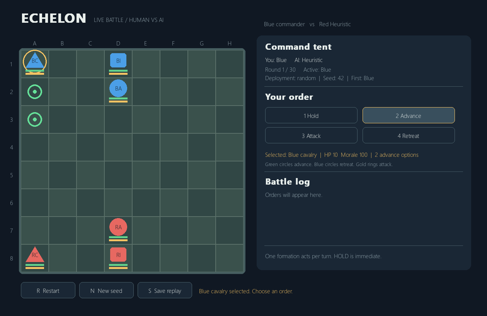
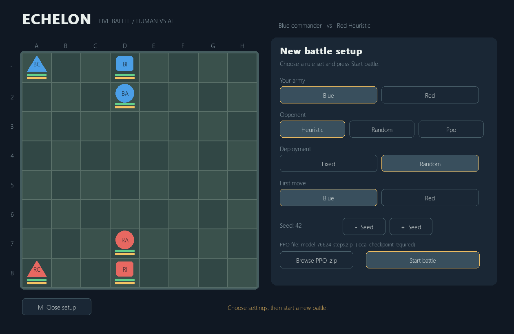

# Phase 8: Human vs AI

Echelon now has a playable Pygame battle screen. The live controller in
`echelon/live_game.py` creates a normal `BattleState`, asks the engine for
`legal_orders()`, and submits only accepted orders through `apply_order()`.
The engine's movement, range, damage, morale, routing, and 30-round tiebreak
rules are unchanged. The live screen in `echelon/play.py` is separate from the
read-only Phase 7 replay viewer.

## Launch on Windows

From PowerShell in the project root, with the project dependencies installed:

```powershell
.\.venv\Scripts\python.exe -m echelon.play
.\.venv\Scripts\python.exe -m echelon.play --human Red --opponent heuristic --first Blue --deployment random --seed 42
.\.venv\Scripts\python.exe -m echelon.play --human Blue --opponent random --first Red --deployment fixed --seed 42
.\.venv\Scripts\python.exe -m echelon.play --human Red --opponent ppo --checkpoint runs/phase6_mixed_50000/checkpoints/model_76624_steps.zip --first Blue --deployment random --seed 54
```

The first command works without a checkpoint: Blue plays against
HeuristicGeneral on the fixed board and acts first. `--human` and `--first`
accept Blue or Red. `--deployment random` uses a mirrored, reproducible
layout from `--seed`; `fixed` uses the original layout. The RandomGeneral
opponent has a separate seed-derived random stream. A missing or incompatible
PPO checkpoint causes a clear startup error and is never replaced silently.
For the selected local Phase 6 checkpoint, `--opponent ppo` alone also uses
the default path above. Model files stay under Git-ignored `runs/` and must
be reproduced locally; see [training.md](training.md) and
[phase6_analysis.md](phase6_analysis.md).





## How to play

1. Click one of your living Blue or Red formations. Its shape identifies its
   type: square infantry, triangle cavalry, circle artillery.
2. Choose **Hold**, **Advance**, **Attack**, or **Retreat** with the screen
   buttons or keys **1–4**. Hold issues the order immediately. Advance shows
   green legal destinations, Retreat shows blue destinations, and Attack
   rings attackable enemies in gold.
3. Click a highlighted square or enemy to issue the order. The AI then makes
   its one order, and your next turn begins. Every unhighlighted move is
   rejected without changing the battle.

Press **M** or click **Setup** to choose your army, opponent, deployment,
first move, and seed inside the game. The setup screen can browse for a PPO
`.zip` checkpoint. Starting a new setup replaces the current battle; a
missing model leaves the current battle intact and shows an error.

The right panel shows the round, active army, selected unit's health and
morale, number of legal options for its chosen order, recent orders, and the
final winner and tiebreak scores. Both armies issue one formation order per
turn. Units below 30 morale route and cannot act.

| Key | Action |
| --- | --- |
| 1 / 2 / 3 / 4 | Hold / Advance / Attack / Retreat |
| R | Restart the same seeded battle |
| N | Start a new battle with seed increased by one |
| S | Save a completed battle to `runs/human_games/` |
| M | Open or close the new-battle setup screen |
| Esc | Close the game |

Saved files use the established Phase 6/7 JSON record format, including
initial deployment, every order, before/after positions, health and morale,
legal orders, damage, casualties, and the terminal result. Saving verifies
the replay through the deterministic engine. Files get a numeric suffix if
the same battle name already exists. Open one with:

```powershell
.\.venv\Scripts\python.exe -m echelon.viewer --file runs/human_games/battle_42_blue_heuristic.json
```

## PPO compatibility

`echelon/encoding.py` contains pure helpers extracted from the original
Gymnasium wrapper. `EchelonEnv` delegates to those helpers, preserving its
63-element `float32` observation, 396 stable action indexes, side-relative
coordinates, and boolean legal mask. The adapter in `echelon/ppo_general.py`
loads a saved MaskablePPO policy, checks its action and observation spaces,
constructs the observation for whichever army the AI controls, predicts with
the engine-derived mask, and decodes the selected engine order. It does not
call `EchelonEnv.step()`, which would play a separate scripted opponent.
Inference is deterministic by default; no model training occurs in a game.

## Validation and limits

Run the complete tests and an automated headless Pygame battle:

```powershell
.\.venv\Scripts\python.exe -m unittest discover -s tests -q
.\.venv\Scripts\python.exe -m echelon.play --human Red --opponent heuristic --first Blue --deployment random --seed 43 --smoke --save-record runs/phase8_smoke.json --screenshot runs/phase8_smoke.png
.\.venv\Scripts\python.exe -m echelon.viewer --file runs/phase8_smoke.json --screenshot runs/phase8_replay_check.png --action-index 10
```

The headless smoke mode chooses engine-legal human orders automatically for
validation; it is not a new AI commander. The UI supports the current 8×8
open board and six formations. The AI responds immediately without an
animation or a human turn timer. Human play has no separate undo command;
restart replays the same seed. Army drafting, terrain, new unit types, and
training changes remain future work.
