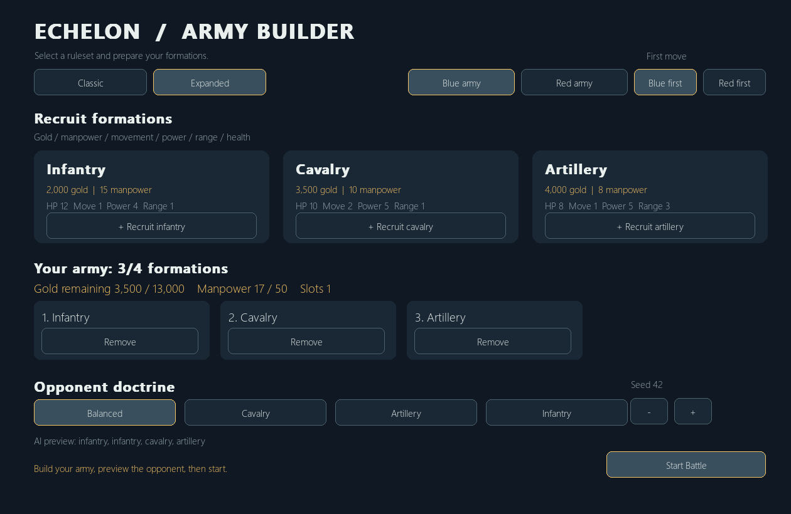
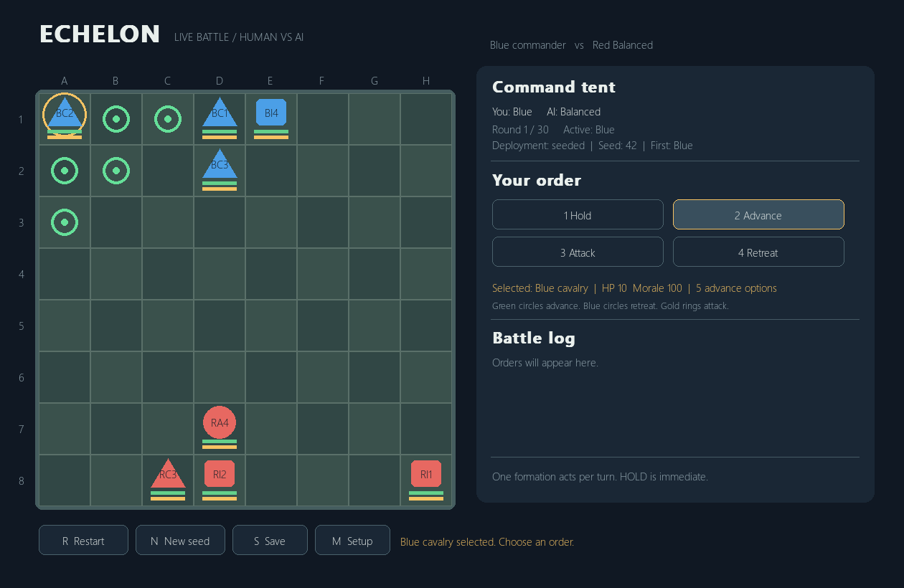

# Phase 9: Expanded army drafting

## Play on Windows

Install the pinned dependencies from the project README. From the repository root:

```powershell
.\.venv\Scripts\python.exe -m echelon.play
.\.venv\Scripts\python.exe -m echelon.army_builder
```

The first command opens the unchanged Classic Human vs AI game. The second
opens the new builder. Select **Classic** in the builder to start an original
fixed-layout battle against HeuristicGeneral, or **Expanded** to draft a custom
roster. Classic's full opponent selection, including the local PPO checkpoint,
remains in `echelon.play`. **The Classic PPO model cannot play Expanded.** Its
63-feature observation and 396-action encoding assume exactly three distinct
formations per side.





Click a unit card to recruit it, or **Remove** on a roster slot for a full
refund. The gold, manpower, and slot counters update immediately. The builder
shows the AI's seeded draft for the selected doctrine. Choose Blue or Red,
which army acts first, a doctrine, and a seed, then click **Start Battle**.
Unaffordable purchases show a warning. Use the Phase 8 mouse controls in
battle: click a friendly formation, choose Hold, Advance, Attack, or Retreat,
and click a highlighted destination or target. Press **M** to return to the
builder; **R** restarts the same seed, **N** advances the seed, and **S** saves
a completed replay. The saved JSON opens in the existing replay viewer.

## Draft rules

Both armies get **13,000 gold**, **50 manpower**, and **one to four**
formations. Duplicates are legal. `echelon/drafting.py` keeps these values in
one configurable `DraftRules` object. Purchasing and removal return a new
roster, which makes seed-based tests and UI validation straightforward.

| Type | Gold | Manpower | HP | Move | Power | Range |
| --- | ---: | ---: | ---: | ---: | ---: | ---: |
| Infantry | 2,000 | 15 | 12 | 1 | 4 | 1 |
| Cavalry | 3,500 | 10 | 10 | 2 | 5 | 1 |
| Artillery | 4,000 | 8 | 8 | 1 | 5 | 3 |

Example legal builds: **3 cavalry + 1 infantry** (12,500 gold, 45 manpower),
**2 infantry + 1 cavalry + 1 artillery** (11,500 gold, 48 manpower), and
**3 artillery** (12,000 gold, 24 manpower). Four infantry cost only 8,000
gold but require 60 manpower, so the builder rejects them.

`echelon/doctrines.py` contains four **programmed**, seed-dependent drafting
preferences: Balanced favors all three types; Cavalry favors three cavalry;
Artillery favors multiple guns; Infantry favors infantry-led rosters.
These are deterministic heuristics, **not trained neural networks**. All
doctrines use the same limits and the same roster-agnostic tactical general.

## Expanded battle and scoring

Each formation gets a unique ID such as `B-C2`; seeded deployment samples
unoccupied cells in Blue rows 0–1 and Red rows 6–7. Movement, attack range,
damage, morale, routing, and turn alternation follow Classic's rules. Expanded
reuses Classic's movement, range, damage, and legal-order helpers, but has a
separate terminal rule. A battle ends on elimination or after 30 full rounds.

For a time-limit battle, each **combat-effective** formation contributes:

`gold cost × remaining HP / maximum HP × current morale / 100`.

The army with greater total remaining strength wins; exact ties draw. Routed
and destroyed formations contribute zero. This compares surviving investment
rather than formation count: one fresh artillery and two fresh infantry both
score 4,000. Unspent gold does not score, so underbuying is a tradeoff.
Because the formula weights expensive troops, it may favor compositions that
spend more gold even when their battlefield position is worse; it is a simple
first tiebreak, not a complete balance model. The test suite checks the
formation-count example and routing behavior.

## Replays and AI tournaments

Completed Expanded games save **version 2** JSON with both rosters, the seed,
starting snapshot, all legal orders and decisions, and the final result. The
loader re-simulates each recorded order to detect corruption. Classic replay
files remain version 1 and continue to use their original validator. The
existing visual viewer handles either version:

```powershell
.\.venv\Scripts\python.exe -m echelon.viewer --file runs/human_games/battle_42_blue_balanced.json
.\.venv\Scripts\python.exe -m echelon.expanded_tournament --battles-per-pair 100 --seed 9000 --output runs/phase9_tournament.json
```

The initial tournament ran **600 battles**: 100 per distinct doctrine pair.
Each pair used 25 deployment/draft seeds, with both doctrine-to-side assignments
and both first-turn choices. Opponent drafts and battle seeds were matched
within each four-battle block. The `runs/` report stores per-battle rosters,
gold, strength, winner, side, and condition. The compact
[tournament summary](phase9_tournament_summary.json) preserves every aggregate,
side-specific, and opponent-specific row in Git. Those four games are correlated,
so the table is exploratory rather than a claim of statistical superiority.

| Doctrine | Battles | W–L–D | Score | Decisive wins | Time-limit wins | Avg. gold spent | Avg. strength left |
| --- | ---: | ---: | ---: | ---: | ---: | ---: | ---: |
| Balanced | 300 | 182–117–1 | 60.8% | 138 | 44 | 12,460 | 3,397 |
| Cavalry | 300 | 220–75–5 | 74.2% | 191 | 29 | 12,340 | 3,363 |
| Artillery | 300 | 118–182–0 | 39.3% | 85 | 33 | 12,000 | 2,724 |
| Infantry | 300 | 75–221–4 | 25.7% | 59 | 16 | 9,880 | 1,007 |

The cavalry draft performed best in this small, fixed-tactical-policy study.
The result may reflect the current movement, damage, or time-limit rules and
the shared tactical heuristic. It does not establish a generally best military
doctrine. The report also contains Blue/Red and opponent-specific rows.

## Validation and limits

```powershell
.\.venv\Scripts\python.exe -m unittest discover -s tests -q
.\.venv\Scripts\python.exe -m echelon.army_builder --roster cavalry cavalry cavalry infantry --smoke --save-record runs/phase9_smoke.json
.\.venv\Scripts\python.exe -m echelon.viewer --file runs/phase9_smoke.json
```

Expanded uses the existing eight-by-eight open board and the original three
unit types. The AI drafting preferences are simple weights; they do not learn
from tournament outcomes. AI orders appear immediately, and the battle screen
has no undo. The 30-round limit can still decide many matchups, so future
balancing should use more deployment seeds and paired uncertainty estimates.
